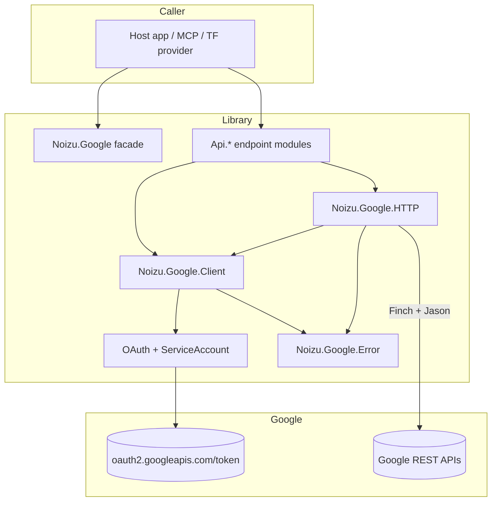

# Project Architecture — `noizu_google`

## Overview

`noizu_google` is a thin, hand-written REST client for five Google marketing
surfaces (Search Console, GA4 Admin, GA4 Data, AdSense Management, Google Ads). It is
not a generated API surface: each endpoint module maps a small number of calls onto
Google's documented REST paths and hands the response back as decoded JSON. There is
exactly one process (a named Finch pool); everything else is functional library code
that the host application calls directly. Architecture is therefore "layered wrapper",
not a service.

The library is the shared foundation of the three-plane marketing control plane
described in [ADR-001](ADR-001-marketing-control-plane.md): an MCP server
(`:noizu_google_mcp`) and a Terraform provider (`noizu/google-marketing`) depend on it
rather than re-implementing OAuth and transport.

## Layering

## Core Components

| Component | Responsibility | Lives in |
|-----------|----------------|----------|
| Facade `Noizu.Google` | `client/0`, base-URL getters | `lib/noizu_google.ex` |
| Application | Starts the Finch pool | `lib/application.ex` |
| `Client` | Credential struct, per-product base URLs, token resolution order | `lib/google/client.ex` |
| `HTTP` | Verb wrappers, JSON encode/decode, bearer headers, form POST | `lib/google/http.ex` |
| `OAuth` | Consent URL, code exchange, refresh, JWT-bearer grant | `lib/google/oauth.ex` |
| `ServiceAccount` | SA JSON validation, RS256 assertion, token mint | `lib/google/service_account.ex` |
| `Api.*` | Path/verb/query mapping per Google product | `lib/google/api/**` |
| `Error` | Structured, non-raising error type | `lib/google/error.ex` |

→ Components ↔ directories: see [PROJ-LAYOUT.md](PROJ-LAYOUT.md).

## Credential Resolution

The single interesting design decision in the library. `Client.ensure_access_token/1`
resolves an access token in this order, first hit wins:

1. `access_token` already set on the client (or app env).
2. Service account — `service_account` map, else `credentials_file` path: build an
   RS256 JWT (`iss`=client_email, `aud`=token_uri, `scope`, 1 h max, optional `sub` for
   domain-wide delegation) and exchange it with the jwt-bearer grant.
3. OAuth `refresh_token` + client id/secret → `oauth2.googleapis.com/token`.

`HTTP` itself does not acquire tokens: it uses the bearer string that is on the client
and calls `Client.require_token/1`, returning a `:config` error when absent. Token
acquisition is therefore opt-in per caller — `ensure_access_token/1` is what the MCP
layer calls at boot.

→ *See [arch/credentials.md](arch/credentials.md) for the full flow*

## Transport

Finch (one named pool, `Noizu.Google.Finch`, started by the application) + Jason.
`HTTP` builds `%Finch.Response{}` handling into `{:ok, decoded}` / `{:error,
%Error{}}`; non-2xx bodies are decoded and summarised into `Error.from_response/2`
(Google's `error.message` + `error.status` tag). `:decode` defaults to `:atoms`.
`Application.get_env(:noizu_google, :request_fun)` is an escape hatch for tests to
intercept requests entirely.

→ *See [arch/transport.md](arch/transport.md) for options and error mapping*

## Key Decisions

- **Hand-written, not generated** — Google's generated clients are large; only a dozen
  endpoints are needed. Cost: each new endpoint is manual work.
- **Errors returned, not raised** — every public function returns a tagged tuple; the
  exception type exists only so `Error` can be `raise`d by callers who want to.
- **Struct-passed client** — no process/global state for credentials, so multiple
  credentials (user OAuth, several service accounts) coexist in one VM.
- **No retries, no pagination helpers, no caching** — left to callers deliberately.
- **`dry_run` is a caller option, not a library default** — the "mutations default to
  validateOnly" guardrail lives in the MCP layer, not here (see
  [THREAT-MODEL.md](THREAT-MODEL.md) T-005).

## Technology Stack

| Layer | Choice |
|-------|--------|
| Language | Elixir 1.20.1 / OTP 29 (`.tool-versions`, CI) |
| HTTP | `finch ~> 0.18` |
| JSON | `jason ~> 1.4` |
| Crypto | `:crypto`, `:public_key` (RS256 assertion) |
| Test | ExUnit + `mimic ~> 1.0` (Finch stubbed), `junit_formatter` |
| Docs | `ex_doc` (README main, extras: runbook, ADR-001) |
| Publish | Hex (`mix hex.build`) |
