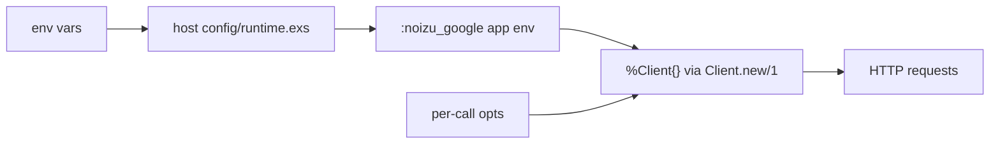

# Project Schema — `noizu_google`

## Scope: there is no persistence layer

This repository has **no database, no Ecto schemas, no Liquibase changelogs, no KV
store, and no data files**. It is a stateless REST client library: data enters as call
arguments, leaves as decoded JSON returned to the caller, and nothing is stored. There
is therefore no ERD and no table catalogue — the Mermaid/PlantUML ERD guidance does not
apply here.

What *is* data, and is documented below: the **configuration schema** (app env →
`%Client{}`), the **environment-variable contract**, the **data-interface schemas** (the
Google request/response shapes this library assembles and returns), and the **test
fixtures**.

→ Layout reference: [PROJ-LAYOUT.md](PROJ-LAYOUT.md), [layout/lib.md](layout/lib.md)

## 1. Configuration schema

`config/config.exs` seeds `:noizu_google`. `Client.new/1` reads the same keys, so app env
and opts are interchangeable (opts win). Every credential key defaults to `nil`.

| Key | Type | Default | Consumed by |
|-----|------|---------|-------------|
| `access_token` | `String.t` \| nil | `nil` | `Client`, `HTTP` bearer header |
| `refresh_token` | `String.t` \| nil | `nil` | `Client.ensure_access_token/1` |
| `client_id` / `client_secret` | `String.t` \| nil | `nil` | `OAuth.token/refresh_token` |
| `credentials_file` | path \| nil | `nil` | `ServiceAccount.load_file/1` |
| `service_account` | `map` \| nil | `nil` | `ServiceAccount.validate/1` |
| `subject` | email \| nil | `nil` | JWT `sub` (domain-wide delegation) |
| `scopes` | `String.t` \| `[String.t]` \| nil | `nil` (SA default = webmasters) | JWT `scope` |
| `developer_token` | `String.t` \| nil | `nil` | Google Ads `developer-token` header |
| `login_customer_id` | `String.t` \| nil | `nil` | Google Ads `login-customer-id` header |
| `api_base` | url | `https://www.googleapis.com/` | `:base` = `:api` |
| `webmasters_base` | url | `https://www.googleapis.com/webmasters/v3/` | `:webmasters` |
| `analytics_admin_base` | url | `https://analyticsadmin.googleapis.com/v1beta/` | `:analytics_admin` |
| `analytics_data_base` | url | `https://analyticsdata.googleapis.com/v1beta/` | `:analytics_data` |
| `adsense_base` | url | `https://adsense.googleapis.com/v2/` | `:adsense` |
| `google_ads_base` | url | `https://googleads.googleapis.com/v17/` | `:google_ads` |
| `oauth_base` | url | `https://oauth2.googleapis.com/` | `OAuth.*` token endpoint |
| `authorize_url` | url | `https://accounts.google.com/o/oauth2/v2/auth` | `OAuth.authorize_url/1` |
| `receive_timeout` | ms | `120_000` | Finch request timeout |
| `pool_timeout` | ms | `60_000` | Finch pool checkout |
| `request_fun` | fun/1 or fun/4 | unset | test/override request interceptor |

`config/test.exs` overrides `access_token` with a fixed placeholder and re-pins two base
URLs. There is no `config/prod.exs` or `config/runtime.exs`; `config/config.exs` does
`import_config "#{config_env()}.exs"`, so `MIX_ENV` values other than `dev`/`test` have
no config file to import (irrelevant when consumed as a Hex dependency, where the host
app owns config).

## 2. Environment-variable contract

The library itself reads **no** environment variables — it reads app env only. These are
the variables the documented wiring (README, runbook, MCP layer) maps onto those keys.
Recorded here as the operational contract, not as library code.

| Variable | Maps to |
|----------|---------|
| `GOOGLE_ACCESS_TOKEN` | `access_token` |
| `GOOGLE_REFRESH_TOKEN` | `refresh_token` |
| `GOOGLE_CLIENT_ID` / `GOOGLE_CLIENT_SECRET` | `client_id` / `client_secret` |
| `GOOGLE_APPLICATION_CREDENTIALS` (also `GOOGLE_CREDENTIALS_FILE`, `GOOGLE_SERVICE_ACCOUNT_FILE`, `GOOGLE_SERVICE_ACCOUNT_JSON`) | `credentials_file` / `service_account` |
| `GOOGLE_SCOPES` | `scopes` (space-separated) |
| `GOOGLE_SUBJECT` / `GOOGLE_IMPERSONATE` | `subject` |
| `GOOGLE_ADS_DEVELOPER_TOKEN` | `developer_token` (read directly by `Api.Ads.Customers`) |
| `GOOGLE_ADS_LOGIN_CUSTOMER_ID` | `login_customer_id` (read directly) |
| `GOOGLE_CLIENT_ID` / `GOOGLE_MARKETING_CLIENT_ID` etc. | Mix tasks only (`google.oauth.*`) |

Source: `docs/oauth-secrets-runbook.md` §4 (that is a runbook for the MCP/TF consumers,
so treat it as the external contract).

## 3. Data-interface schemas

Outbound request shapes are plain Elixir maps handed to `Jason.encode/1`; inbound shapes
are Google's JSON decoded per `:decode`. The library does not define structs for them.

| Call | Path | Body / query |
|------|------|--------------|
| `SearchConsole.Sites.list/get/add/delete` | `webmasters/v3/sites[/{encoded siteUrl}]` | none; `{}` on PUT |
| `SearchConsole.SearchAnalytics.query/3` | `sites/{siteUrl}/searchAnalytics/query` | map: `startDate`, `endDate`, `dimensions`, `rowLimit`, … |
| `SearchConsole.Sitemaps.*` | `sites/{siteUrl}/sitemaps[/{encoded feedpath}]` | none |
| `AnalyticsAdmin.Accounts.list/get` | `v1beta/accounts[/{account}]` | query `pageSize`, `pageToken`, `showDeleted` |
| `AnalyticsAdmin.Properties.{list,get,create,patch,delete}` | `v1beta/properties…` | list query `filter` (API-required), `pageSize`, `pageToken`, `showDeleted`; property map on create/patch (+ `updateMask`) |
| `AnalyticsAdmin.DataStreams.{list,get,create,patch,delete}` | `v1beta/properties/{p}/dataStreams…` | stream map on create/patch |
| `AnalyticsData.Reports.run_report/3` | `v1beta/properties/{p}:runReport` | map: `dateRanges`, `dimensions`, `metrics`, … |
| `AdSense.Reports.generate/2` | `v2/accounts/{a}/reports:generate` | query: `startDate.{year,month,day}`, `endDate.*`, `metrics`, `dimensions`, `currencyCode`, `limit` |
| `Ads.Customers.search/3` | `v17/customers/{cid}/googleAds:search` | map: `query` (GAQL string) |
| `Ads.Customers.mutate/3` | `v17/customers/{cid}/googleAds:mutate` | map + injected `partialFailure`, optional `validateOnly` |

Path-segment encoding: `Api.encode_site_url/1` and `Api.encode_feedpath/1` use
`URI.encode/2` with `URI.char_unreserved?/1`; Ads customer ids are reduced to digits
(`~r/\D/` → `""`).

Return contract for every call: `{:ok, decoded}` | `{:error, %Noizu.Google.Error{}}`
where the error struct carries `message`, `status`, `body`, `reason`, `summary`, `tag`.

## 4. Test fixtures

| Fixture | Shape | Notes |
|---------|-------|-------|
| `test/support/sa_fixture.ex` — `creds/1` | service-account map: `type`, `project_id`, `private_key_id`, `private_key` (PEM), `client_email`, `client_id`, `token_uri` | RSA-2048 key generated at runtime; never a real key |
| `sa_fixture.ex` — `write_temp!/1` | writes `creds/1` to `System.tmp_dir!()` | test-scoped temp file |
| `test/support/finch_stub.ex` — `json_response/2` | `%Finch.Response{status, body, headers}` | feeds Mimic'd `Finch` |

There is no seed data, corpus, or static data directory.

## Migration history

None — no schema to migrate.
