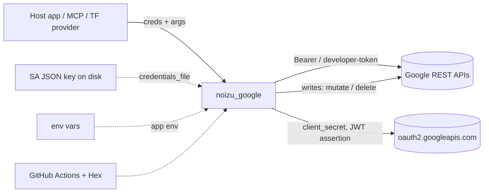

# Threat Model — `noizu_google`

## Overview

`noizu_google` is a client-side library with **no listening surface of its own**: it
opens no ports, serves no routes, and stores nothing. Its security posture is therefore
entirely about (a) the credentials it holds and transmits, (b) where it transmits them,
and (c) what it lets a caller do to Google accounts that own real money and real
property data — AdSense earnings, Google Ads spend, GA4 property configuration, Search
Console site ownership.

Crown jewels, in order: the **service-account private key** and **OAuth refresh token**
(long-lived, full account authority); the **access token** (short-lived bearer); the
**Google Ads developer token**; and the **write authority** itself (a mutate or delete
call is a real-world action with no undo).

## Trust Boundaries

| # | Boundary | Crossing |
|---|----------|----------|
| B1 | Host application ↔ library | Credentials and arguments supplied in-process (caller is trusted code) |
| B2 | Library ↔ Google REST APIs | HTTPS egress carrying bearer tokens; TLS verified by Finch defaults |
| B3 | Library ↔ OAuth token endpoint | HTTPS POST of client secret / signed JWT assertion |
| B4 | Repo ↔ developer machine | Service-account JSON keys and runbook-stored secrets live on disk, never in git |
| B5 | CI/build ↔ dependency registries | Hex packages (`finch`, `jason`, …) and GitHub Actions |
| B6 | Secret store ↔ runtime | `dc`/Infisical → env vars → app env (external to this repo) |

## Attack Surface

Enumerated ingress: per-call opts (`client`, `base`, `headers`, `decode`, `auth`,
`query`), app env (`:noizu_google`, including `:request_fun`), the credentials file
path, and environment variables read by the Ads wrapper and Mix tasks. There is no
network ingress, no webhook, no queue consumer, no agent tool endpoint (those are the
MCP layer's, out of scope here).

## Vulnerability Register

| ID | Severity | STRIDE | Component | Status |
|----|----------|--------|-----------|--------|
| T-001 | High | Information disclosure | `%Client{}` has no redacting `Inspect` — `inspect(client)`, `Logger.info(client)` or a crash report dumps `access_token`, `refresh_token`, `client_secret`, and the whole `service_account` map including `private_key` | Open |
| T-002 | Medium | Information disclosure / Tampering | `:base` accepts an arbitrary absolute URL string and the bearer token is attached to it — a base URL sourced from untrusted config sends the token to a third-party host | Open (accepted: config is trusted input) |
| T-003 | Medium | Tampering / Spoofing | `authorize_url/1` passes `state` and PKCE params through but generates and validates neither — no CSRF or code-interception protection is provided to callers | Open |
| T-004 | Medium | Tampering | `Application.get_env(:noizu_google, :request_fun)` replaces the entire HTTP call (url, headers, body incl. bearer) — a value injected into app env intercepts every credential | Open (test seam, unset in prod) |
| T-005 | Medium | Elevation of privilege / Tampering | No in-library guardrail on destructive calls: `Properties.delete`, `DataStreams.delete`, `Sitemaps.delete`, `Ads.Customers.mutate` apply immediately. `validateOnly`/"confirm" gating lives in the MCP layer, not here | Open (accepted by design) |
| T-006 | Medium | Information disclosure | `.gitignore` covers `_build`, `deps`, `cover`, `doc`, tarballs — **not** `*.json`, so a downloaded service-account key dropped in the checkout can be committed | Open |
| T-007 | Medium | Denial of service | `:decode` defaults to `:atoms`; `Jason.decode(body, keys: :atoms)` on Google responses creates atoms from remote keys (pre-existing atoms are safe, novel ones are permanent) | Open |
| T-008 | Low | Information disclosure | `Error.body` retains the full decoded Google response and `summary`/`message` embed it; `Client.refresh_user_token` and `ServiceAccount.take_access_token` build `:config` errors with `inspect(other)` of the token-endpoint response — a caller logging errors may log token-adjacent material | Open |
| T-009 | Low | Tampering | `list_campaigns/2` interpolates `:limit` into the GAQL string (`LIMIT #{limit}`) with no integer coercion — caller-controlled query injection into a read-only query | Open |
| T-010 | Low | Tampering | `ServiceAccount.load_file/1` reads whatever path it is given and does not check file mode/ownership; a world-readable key is used without warning | Open |
| T-011 | Low | Tampering | CI pins `erlef/setup-beam` to a commit SHA but uses `actions/checkout@v4` and `actions/cache@v3` by tag; Hex deps are semver-ranged (resolved by `mix.lock`) | Partial |
| T-012 | Low | Elevation of privilege | `login-customer-id` is reduced to digits (`~r/\D/`) and customer ids likewise, so MCC targeting cannot be path-injected — recorded as a **control**, not a gap | Mitigated |

## Mitigation Coverage

3 mitigations recorded (path encoding via `URI.char_unreserved?/1`; digit-only customer
and login ids; TLS-by-default with no plaintext base URLs shipped), 1 partial (CI
pinning), 10 open — of which T-002, T-004, T-005 are **accepted design decisions**
documented in [PROJ-ARCH.md](PROJ-ARCH.md), and T-001 is the highest-value fix.

## Residual Risk

Accepted, with rationale:

- **Library cannot police its caller.** Credentials are supplied by trusted in-process
  code; the library's job is to not leak them, not to police their source (T-002, T-004).
- **Destructive actions are the point** of the Ads/GA write wrappers. Guardrails belong
  in the agent-facing MCP layer (ADR-001), which the runbook states defaults mutates to
  `dry_run=true` with `confirm=true` for live calls. Nothing here enforces that.
- **No audit trail.** The library emits no telemetry; repudiation is the caller's
  problem, and for spend-affecting mutates the MCP layer is expected to log.
- **No rate limiting or retry logic**, so a runaway caller hammers Google rather than
  this library — Google's quota is the backstop.

## References

- → [`arch/credentials.md`](arch/credentials.md) — how tokens and keys flow
- → [`arch/transport.md`](arch/transport.md) — headers, decode, error bodies
- → [`oauth-secrets-runbook.md`](oauth-secrets-runbook.md) §8 — MCP `dry_run`/`confirm` policy
- → [`ADR-001-marketing-control-plane.md`](ADR-001-marketing-control-plane.md) — where guardrails are meant to live
