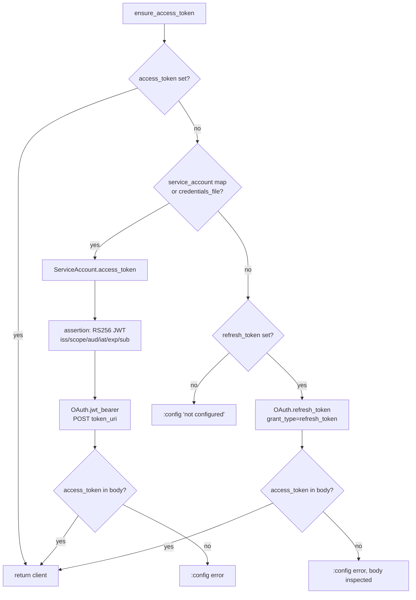

# Credential resolution

How `Noizu.Google.Client` turns configuration into a usable bearer token.

## Sources

`Client.new/1` fills each field from the opts map, falling back to
`Application.get_env(:noizu_google, key, default)`. Nothing is read from the
filesystem at construction time — `credentials_file` is just a path string.

| Field | Meaning |
|-------|---------|
| `access_token` | Pre-obtained bearer token (short-lived, caller-managed) |
| `refresh_token` | User OAuth refresh token |
| `client_id` / `client_secret` | OAuth client for refresh/token exchange |
| `service_account` | Already-decoded SA JSON map |
| `credentials_file` | Path to SA JSON (expanded with `Path.expand/1`, `~` allowed) |
| `subject` | `sub` claim for domain-wide delegation |
| `scopes` | String or list; SA grant defaults to `Scopes.search_console/0` |

## Resolution order (`ensure_access_token/1`)

Notes drawn from the source:

- The SA branch wins over refresh even when both are configured.
- `ServiceAccount.access_token/2` accepts either a path or a validated map; `load_file/1`
  is only called for paths.
- JWT lifetime is clamped: `min(lifetime, 3600)`, `max(..., 1)`.
- The refresh branch inspects the full response map when `access_token` is missing
  (`Error.config("refresh_token response missing access_token: #{inspect(other)}")`) —
  a token-endpoint response echoed into an error message (see THREAT-MODEL T-007).
- `HTTP` never calls `ensure_access_token/1`; it calls `Client.require_token/1`, so a
  caller that skips the resolution step gets `{:error, :config}` rather than a silent
  unauthenticated request.

## Google Ads extras

`Api.Ads.Customers` adds two headers per call, resolved independently of the client
struct: `developer-token` and optional `login-customer-id` — from opts, then app env
(`:developer_token`, `:login_customer_id`), then `GOOGLE_ADS_DEVELOPER_TOKEN` /
`GOOGLE_ADS_LOGIN_CUSTOMER_ID`. A missing developer token is a `:config` error; the
access token here must carry the `adwords` scope.

## Operational bootstrap

`mix google.oauth.authorize` + `mix google.oauth.exchange --write-dc` implement the
consent flow and can persist `client_id`/`client_secret`/`refresh_token` to
direnv-config. That path stores secrets in an external store (`dc`/Infisical) — the
library never writes credential files itself. See
[../oauth-secrets-runbook.md](../oauth-secrets-runbook.md).
